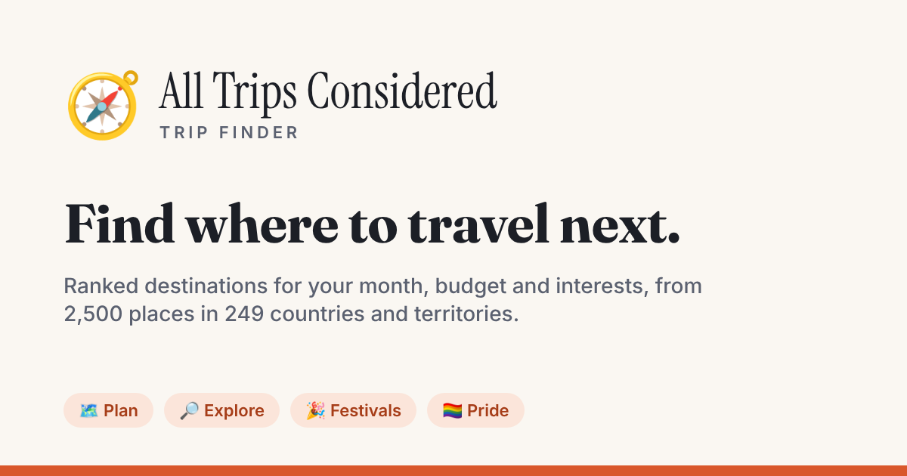

# Trip Finder

An interactive trip finder that helps visitors decide which region, country and cities to visit.

Live site: https://tripfinder.alltripsconsidered.com/



## Features

- **Five-step quiz.** Interests (like or must-have), travel month, trip length, daily budget, ideal weather, travel companions, crowd preference, home region and excluded regions.
- **Ranked results.** The app ranks 13 world regions and 249 destinations: every sovereign country (187 countries plus 10 microstates such as Monaco and Singapore, 197 in all) and 52 territories. Each match comes with plain-language reasons and warnings, such as "July is off season" or "Pricier than your budget". Tapping a summary chip edits that answer, and Cancel puts the earlier answers back.
- **Territories, microstates and micronations.** The territories cover every inhabited overseas territory of the United States, United Kingdom, France, the Netherlands, Denmark, Norway, New Zealand, Australia and China. They also include the British Crown Dependencies (Jersey, Guernsey and the Isle of Man) and remote islands such as Bouvet Island and Heard Island. Each territory stays in its region, and choosing Territories in the Location type filter groups them under the country they belong to. Four visitable micronations, such as Užupis, appear as places in their host countries with a MICRONATION tag. Choosing Micronations in the Location type filter lists just them under their host countries. The small microstates name their best day-trip base and link from their neighbour.
- **Places.** Together the destinations cover 2,569 cities and places, including a place for every UNESCO World Heritage Site. A site shared by several countries keeps one place, which Explore also lists under the other countries (the `LINKED` map, `data/places/linked.json`).
- **Explore mode.** Browse every destination with search and filters for region, month, interest, location type and cost. Each country card keeps its places behind a Show places button, but a search opens the cards it narrows, so the matching places show at once.
- **Explore filters.** Explore can also filter UNESCO sites (World Heritage, Global Geoparks or Biosphere Reserves). It can show only national parks, historic sites, family-friendly places, festivals, Christmas markets or Pride events. It can filter by population (uninhabited, no permanent residents, or expedition only), by LGBTQ+ climate (welcoming, mixed or caution) and by travel advisory (no advisory, reconsider travel or do not travel).
- **Accent-free search.** Searching ignores accents, so "galapagos" finds Galápagos and "reykjavik" finds Reykjavík. Words in descriptions match from their start, or as the end of a longer word, so "forest" finds rainforests and "holi" finds Holi but not "Catholic". A country's own description lists all its places only when none of them matches.
- **Search by code or other name.** Explore search finds a destination by its two-letter code (FR, DE, GB) or a common short or alternative name (US, USA, UK, UAE, Holland, Burma, Ivory Coast). An exact code or name lists just that destination. Other names live in `data/places/country-aliases.json`.
- **Country facts.** Every destination lists its capital and famous national parks and trails. Places that are the capital carry a CAPITAL tag, and Explore search covers these facts.
- **US states and Canadian provinces.** The US has a place in all 50 states plus D.C., and Canada in all 10 provinces and 3 territories. Each of these places shows its state or province and uses its own monthly temperatures. Places in the US, Puerto Rico, Canada and Mexico take their average daily highs from the climate table in their Wikipedia article (mostly 1991–2020 normals), or from the nearest town with one.
- **Grouping by subdivision.** Explore groups the US and Canada by state or province, and the United Kingdom by its four countries (England, Scotland, Wales and Northern Ireland). It also groups 94 other destinations by their own subdivisions, named in `data/places/area-terms.json`. Examples include:
  - Germany (states), Switzerland (cantons) and Spain (autonomous communities)
  - Mexico and Brazil (states), and Argentina and Iran (provinces)
  - Japan (prefectures), South Korea and China (provinces), and Taiwan (counties and cities)
  - India (states and union territories) and Australia (states and territories)
  - Hong Kong (Hong Kong Island, Kowloon and the New Territories) and Macau (Macau Peninsula, Taipa, Cotai and Coloane)
  - Vietnam (North, Central and South) and the Philippines (Luzon, Visayas and Mindanao)
  - New Zealand (its islands), Ireland (provinces), Jamaica (parishes) and French Polynesia (archipelagos)

  A country is grouped only when it has more than five places in the results. Smaller lists show the subdivision in each row.
- **Stay limits.** Tiny places get a capped stay, such as one day for Vatican City, and the app suggests where to spend the rest of the trip.
- **Suggested route.** Each country card splits your trip days across its best stops. Places closed to tourists (UNINHABITED) stay in the ranked list but never become a stop. For trips of three weeks or more, or when a destination cannot fill the whole trip, it also suggests a neighbouring country to pair with.
- **Place details.** A details view for each city shows interest ratings, a 12-month temperature chart with the best months marked, typical cost, currency and language.
- **Festivals and Pride.** Major festivals and holidays, 125 Pride events and 48 Christmas markets are attached to their places in the `FESTIVALS` map, each with its usual months and a short note. Places with one carry a FESTIVAL tag, and their details list each event (Pride events are labelled PRIDE). Searching works like this:
  - A festival's name finds it, and "festivals" or "holidays" lists them all.
  - "pride", "gay", "queer" or "LGBTQ" lists every Pride event.
  - "christmas markets" (or "xmas market", "advent market" or "christkindl") lists the 48 Christmas markets, which are tagged `"market"` and labelled CHRISTMAS MARKET.
  - A month in the search ("pride in june") or the "Good in" filter narrows them. With Show only set to Festivals, Christmas Markets or Pride, the month means "an event is on then" rather than the best season.
- **Shortlist.** Save cities and countries, then compare them side by side. The shortlist is stored in the browser.
- **Shortlist export.** The Shortlist can be saved as a CSV, JSON or plain-text file. Each file lists the saved places with their best time, typical high and low, daily cost and strengths, followed by any saved countries.
- **Shareable links.** Your quiz answers are encoded in the URL, so a link reproduces the same results. Explore and every place also have their own web address (see [Web addresses](#web-addresses)).
- **Appearance panel.** The button at the top right opens the same Appearance panel as the other All Trips Considered tools.
  - **Mode** picks Auto (follow the device), Light or Dark.
  - **Color** picks Automatic (the default), Classic, one of the four seasons or one of the holidays, each with its emoji and a color swatch. Automatic changes the accent color with the season, flipped for southern hemisphere time zones. It also changes for New Year, Lunar New Year, Valentine's Day, St. Patrick's Day, Easter, Pride Month, Halloween, Diwali and Christmas, using the device's own date and time zone. A picked season gives way to holiday colors while a holiday lasts and then returns. A picked holiday stays until the visitor chooses Automatic again. With a mouse or trackpad, hovering a color previews it across the page.
  - **Decorations** (on by default) shows the colored stripe under the top bar and the season's or holiday's emoji on the button. Turned off, the button shows a plain half-moon icon.
- **Device settings.** Temperatures, distances, numbers and dates follow the device. Its region decides °C or °F and kilometres or miles (US English shows °F and miles, UK English °C and miles, most others °C and kilometres). Its locale formats numbers ("1,400" or "1.400"), and the shortlist export uses the device's own date. The CSV and JSON exports keep both temperature columns.
- Light and dark themes, mobile layout and keyboard support.

### Web addresses

On the live site, Explore lives at `/explore/` and each place at `/place/<id>/`, for example `/place/jp-kyoto/`. Opening a place in the app moves the address there, and closing it returns to the address it was opened from, so one Back then leaves the view. Back and Forward also move between places. The Shortlist (`/#shortlist`) and quiz results (`/#r-…`) stay on the home page, since they belong to one visitor. Copies of the app that are not on the live domain or localhost, such as a `file://` page or an embedded preview, keep to `#explore`-style links.

Each address also has its own static page with a title, description, canonical address, link-preview tags, schema.org structured data (`TouristDestination` and a breadcrumb trail) and a no-JavaScript summary. The summary gives the best months, typical highs, cost, World Heritage, national parks, festivals and nearby places. Each view has one main heading and its own page title, and an open place titles the tab with its name.

### Install and offline use

The app is a Progressive Web App. `docs/manifest.webmanifest` and the icons in `docs/img/` make it installable, and `docs/sw.js` caches the app so it works offline after the first visit. Each page is cached under its own address once visited. Offline, a page not yet visited opens the home page.

`docs/js/install.js` prompts visitors to add the app to their home screen:

- **Chrome, Edge and Android:** an Install button opens the browser's own install dialog.
- **iPhone and iPad:** browsers there have no install API, so the prompt shows the steps (tap Share, then Add to Home Screen).

The prompt appears only after the visitor sees results or spends 25 seconds on the page. It never appears once the app is installed or inside an embedded frame, and it stays hidden for 24 hours after the visitor taps Close.

### How scoring works

`docs/js/engine.js` scores every city from 0 to 100 using a weighted blend of six factors:

| Factor | Weight | Notes |
| --- | --- | --- |
| Interest fit | 40% | Uses your liked and must-have interests, nudged by who you travel with |
| Season | 15% | Best months score highest. Flexible dates reduce this weight. |
| Budget | 15% | Penalises countries above your daily budget. Luxury instead gives pricier countries a small lift. |
| Distance | 15% | Only applies when you give a home region and a distance preference. Measured to each place, so New York and San Francisco differ. |
| Climate | 12% | Average daily high in your month against your preferred range |
| Crowds | 8% | Iconic versus off the beaten path |

Unused factors drop out and the remaining weights are rescaled. A country's score is the average of its best cities for your trip length. A region's score is the average of its top two countries.

## Privacy

Trip Finder saves your trip preferences, saved places, appearance settings and when you closed the install prompt in your browser's local storage. All of it stays in the browser on your device, and nothing is uploaded: there are no accounts, cookies, analytics or tracking. The full policy is in [`docs/privacy.html`](docs/privacy.html).

## Project structure

Everything the site serves lives in `docs/`, which GitHub Pages publishes. Development files stay at the repository root and are not published.

```
docs/index.html               App shell and home page
docs/privacy.html             Privacy policy
docs/CNAME                    Custom domain for GitHub Pages
docs/css/styles.css           Styles and theme tokens
docs/css/privacy.css          Styles for the privacy page
docs/css/fonts.css            Font declarations for the self-hosted fonts
docs/fonts/                   Fraunces, Instrument Serif and Inter (WOFF2), OFL.txt and a README
docs/js/data.js               Generated from data/ by npm run build; do not edit
docs/js/engine.js             Scoring, itinerary logic and color schemes (no DOM)
docs/js/app.js                UI rendering, interactions and web addresses
docs/js/install.js            Install prompt and service worker registration
docs/js/theme-boot.js         Applies the saved light or dark mode on the privacy page
docs/sw.js                    Service worker (at the top of docs/ so it covers every page)
docs/manifest.webmanifest     App name, colours and icons for installing
docs/img/                     App icons, favicon.ico (the app icon), browser tab icons (tabicon-32.png and tabicon-192.png, the All Trips Considered artwork) and the link-preview image
docs/explore/, docs/place/    Generated pages (npm run build)
docs/sitemap.xml              Generated list of every address
docs/robots.txt               Crawling rules
README.md                     This file
data/                         The dataset as JSON files (see data/README.md)
tools/build-data.js           Builds docs/js/data.js from data/
tools/build-pages.js          Builds the Explore and place pages and the sitemap
tools/data-files.js           Where each part of the dataset lives in data/
tools/fill_coords.py          Adds Wikipedia coordinates to places that lack them
tools/coords_tried.json       Wikipedia titles fill_coords.py has already checked
tools/unesco/                 UNESCO Global Geopark and Biosphere Reserve lists (JSON and CSV) and their scripts
tools/parks/                  CONANP's Mexican protected areas, park site coordinates and the gateway linker
package.json                  npm scripts for serving and building
package-lock.json             npm lock file
```

### Data design

The data lives in `data/` as JSON files, one per destination plus one per topic. `data/README.md` explains the format and which file holds each map named in this README. For example, `UNESCO` is `data/unesco/world-heritage.json` and `FACTS` is `data/facts/capitals-and-parks.json`. `docs/js/engine.js` has no DOM code; the season and holiday color schemes live in its `SEASON_SCHEMES`.

## Run locally

The app needs a local web server: the `/explore/` and `/place/<id>/` addresses and the service worker do not work from a `file://` page. No dependencies are needed. Serve the `docs/` folder with:

```bash
npm start
```

Open http://localhost:8080.

## Making changes

### Rebuilding generated files

After changing anything in `data/` or `docs/index.html`, rebuild `docs/js/data.js`, the Explore and place pages and `docs/sitemap.xml`:

```bash
npm run build
```

`npm run build:data` and `npm run build:pages` run the two steps separately. To confirm that `docs/js/data.js` and the pages match `data/` without rewriting anything:

```bash
node tools/build-data.js --check
node tools/build-pages.js --check
```

`tools/build-pages.js` generates `docs/explore/index.html` and `docs/place/<id>/index.html` from `docs/index.html`, and writes `docs/sitemap.xml` with every address. Other search basics:

- `docs/index.html` carries the home page's description, canonical address, Open Graph and X preview tags (with `docs/img/og-image.png`, 1200 × 630), and structured data for the site, the app and All Trips Considered.
- `docs/robots.txt` allows crawling and points to the sitemap.

### Adding a destination or place

- To add a destination, add a line to the `cities` list in its file in `data/countries/`, then run `npm run build`.
- A place can take a sixth element, `{ area, temps }`, giving its state or province and its own monthly highs.
- Capitals and parks live in the `FACTS` map.
- Microstates and territories also take `kind`, `status` (shown to visitors), an optional `of` and an optional `maxDays`. `of` is a related country id used for pairing and the "Nearby microstates" line.
- Territories name their country in `sovereign`, and day-trip microstates name their base in `visitFrom`.
- Micronations are ordinary places listed in the `MICRONATIONS` map.
- Places where nobody lives permanently are listed in the `REMOTE` map. They are labelled UNINHABITED when closed to tourists, NO PERMANENT RESIDENTS when ordinary visits are possible, and EXPEDITION ONLY when only expedition cruises, liveaboards or permit trips go.

### Typical lows

Typical lows come from the `RANGES` map. It holds each place's average daily temperature range by month from NASA POWER climate averages (MERRA-2 reanalysis). A low is that month's high minus the range.

Ocean-dominated grid cells understate the daily swing on islands and coasts. So every range is raised to a floor of 6 °C within 30° of the equator and 5 °C elsewhere.

### National parks and historic sites

National parks reach places in three ways: through park system sites, the `SITE_PLACES` map and the `NP_EXTRA` map. `SITE_PLACES` also tags a gateway place within about 1.5 hours when a park has no place of its own.

- **Mexico.** Mexico's 132 federal national parks, biosphere reserves and natural monuments come from CONANP's official SIMEC register. `tools/parks/mexico.py` saves them as `tools/parks/mexico_anp.json` and `.csv`, and they join the US and Canadian park systems in `PARK_SYSTEMS`.
- **Historic sites.** US and Canadian historic sites, historical parks, memorials, battlefields and military parks carry their own HISTORIC SITE label instead of NATIONAL PARK.
- **Other US park units.** US National Monuments, National Preserves, National Reserves, National Recreation Areas, National Seashores and National Lakeshores carry the NATIONAL PARK label the same way, through their own place or a gateway place within about 1.5 hours. Those farther from any place still answer a search for their name.
- **Extra park names.** `NP_EXTRA` also tags Hong Kong and Macau country parks, Taiwan's National Scenic Areas and Mexico's biosphere reserves as national parks.

Sites with no place of their own link to the nearest place within about 1.5 hours (110 km):

1. `tools/parks/geocode_sites.py` finds their coordinates in OpenStreetMap (`tools/parks/site_coords.json`).
2. `node tools/parks/link_sites.js` writes the links into `SITE_PLACES` (and `HISTORIC_EXTRA` for places in a territory).

In Explore search, matching sites with no place nearby are listed in their own "No place nearby" card rather than under their country. Each has a link to its nearest place and the distance (the `NEAREST_PLACE` map, also written by `link_sites.js`).

### UNESCO World Heritage

To label a place as UNESCO World Heritage, add its id and site name to the `UNESCO` map (`data/unesco/world-heritage.json`). The app labels these places WORLD HERITAGE. The app refuses to load if an id does not match a place.

### UNESCO Global Geoparks and Biosphere Reserves

Global Geoparks and Biosphere Reserves use the `GEOPARKS` and `BIOSPHERES` maps. `tools/unesco/` holds UNESCO's own lists:

- `geoparks.json` and `.csv`: all 241 UNESCO Global Geoparks, from unesco.org/en/iggp/geoparks.
- `biosphere-reserves.json` and `.csv`: all 797 Biosphere Reserves in 145 countries, from unesco.org/en/mab/list.

`geoparks.py` and `biospheres.py` build these lists from a saved copy of each page. `fetch_details.py` adds each site's centre, area and year. Reserve centres come from UNESCO's pages; Geopark centres come from OpenStreetMap, with 31 set by hand.

`node tools/unesco/link.js` then writes the `GEOPARKS` and `BIOSPHERES` maps (`data/unesco/geoparks.json` and `data/unesco/biosphere-reserves.json`). A site links to up to three places in its own country (or that country's territories) within the radius of its area plus 35 km, capped at 160 km. 111 Geoparks reach 163 places and 384 reserves reach 549 places; the rest have no place nearby. A few centres that fell outside their country are corrected in `link.js`. These places carry GEOPARK and BIOSPHERE labels, and the UNESCO sites filter can show only them.

### Color schemes

The season and holiday schemes live in `SEASON_SCHEMES` in `docs/js/engine.js`. Each passes WCAG AA contrast. Lunar New Year and Diwali dates are listed through 2035, so add later years there when needed.

### Releasing an update

When any cached file changes, bump `CACHE` in `docs/sw.js` (for example from `wtt-v129` to `wtt-v130`) and add any new files to its `SHELL` list, so returning visitors get the new version. Service workers need HTTPS, which GitHub Pages provides.

## Security

- **Content-Security-Policy.** `docs/index.html`, `docs/privacy.html` and every generated page carry a `<meta>` policy that allows scripts, styles, fonts, images and requests only from this site, with no inline code and no `eval`.
- **No inline styles.** The policy blocks `style="…"` in rendered HTML. Use a class, or put a computed value in `data-css` (for example `data-css="height:40%"`), which `docs/js/app.js` applies through the CSSOM. Season colors use a constructed stylesheet for the same reason.
- **Self-hosted fonts.** Fraunces, Instrument Serif and Inter live in `docs/fonts/` (Latin and Latin Extended) and load through `docs/css/fonts.css`, so pages make no requests to Google or any other third party. Each file name carries the font's version; give a new version a new name.
- **Checked input.** Shared links, saved quiz answers, the saved theme and saved places are checked against known values before use, and id lookups ignore names such as `constructor`. Rendered text goes through `esc()`.

### Headers to set in Cloudflare

GitHub Pages cannot send custom headers, so they are set with a Cloudflare Transform Rule (Rules > Transform Rules > Modify Response Header) for `tripfinder.alltripsconsidered.com`:

- `Content-Security-Policy: default-src 'self'; script-src 'self'; style-src 'self'; font-src 'self'; img-src 'self'; connect-src 'self'; manifest-src 'self'; worker-src 'self'; object-src 'none'; base-uri 'none'; form-action 'none'; upgrade-insecure-requests; frame-ancestors 'none'`
- `Strict-Transport-Security: max-age=63072000; includeSubDomains`
- `X-Content-Type-Options: nosniff`
- `X-Frame-Options: DENY`
- `Referrer-Policy: strict-origin-when-cross-origin`
- `Permissions-Policy: camera=(), microphone=(), geolocation=(), payment=(), usb=(), browsing-topics=()`
- `Cross-Origin-Opener-Policy: same-origin`

## Deployment

GitHub Pages publishes the `/docs` folder of the `prod` branch (Settings > Pages > Deploy from a branch). `docs/CNAME` sets the custom domain, and Cloudflare provides DNS. `prod` is the default branch. Changes reach it only through an approved pull request, and the site updates a few minutes after a merge.

After a release, submit `https://tripfinder.alltripsconsidered.com/sitemap.xml` in Google Search Console to speed up indexing.

## Roadmap

- [ ] **Monthly official-list check.** A scheduled task that re-downloads the official lists (UNESCO, the US National Park Service, Parks Canada and CONANP), compares them with the app and reports new, removed or renamed sites for review. Nothing would publish on its own.

## Disclaimer

Temperatures, costs and seasons are rough planning guides, not authoritative travel advice.

## Credits and licenses

- **Fonts.** Fraunces, Instrument Serif and Inter are licensed under the SIL Open Font License 1.1. The license text is in `docs/fonts/OFL.txt`.
- **Climate data.** Typical daily temperature ranges come from NASA POWER climate averages (MERRA-2 reanalysis). Average daily highs for places in the US, Puerto Rico, Canada and Mexico come from the climate tables in their Wikipedia articles. Places whose climate is far from their country's, such as Bogotá, Ushuaia, Leh and Lima, take their highs from the climate table of a nearby weather station in its Wikipedia article. About 30 with no fitting station, such as remote parks and plateaus, use NASA POWER climate averages for 2001 to 2024, adjusted to the height of the ground around them.
- **UNESCO lists.** World Heritage Sites, UNESCO Global Geoparks (unesco.org/en/iggp/geoparks) and Biosphere Reserves (unesco.org/en/mab/list).
- **Parks.** Mexico's protected areas come from CONANP's SIMEC register. The US and Canadian park systems cover the US National Park Service and Parks Canada.
- **Coordinates.** Park site and Geopark coordinates come from OpenStreetMap, and `tools/fill_coords.py` fills in missing place coordinates from Wikipedia.

<p align="center">
  
</p>

<p align="center">© 2026 All Trips Considered. All rights reserved.</p>
